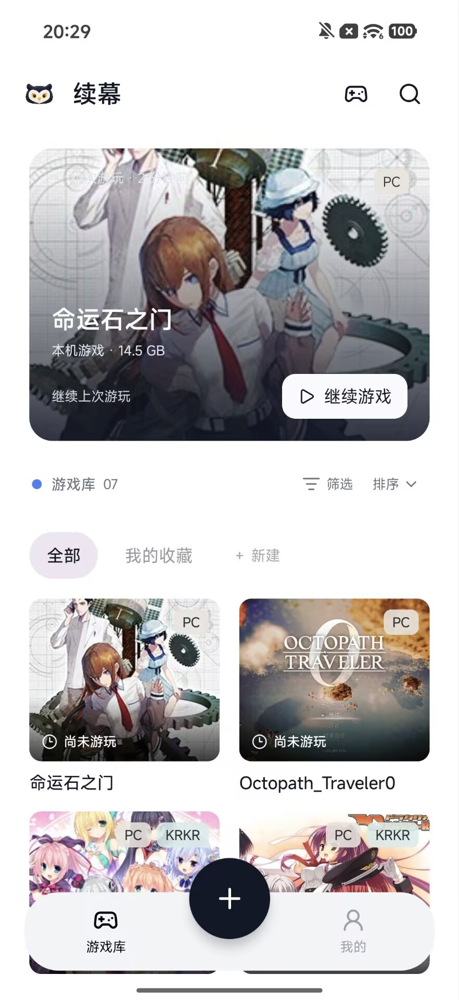
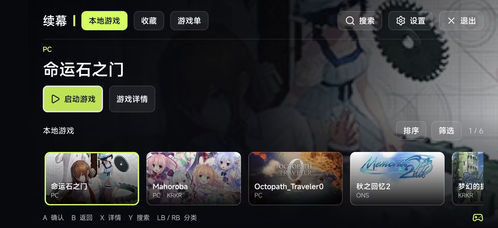
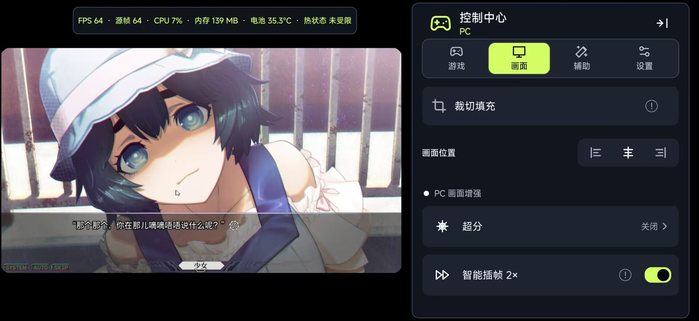
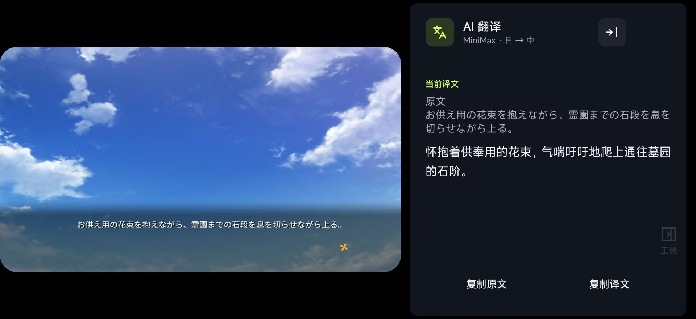
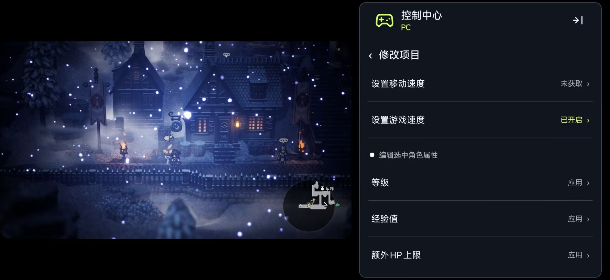
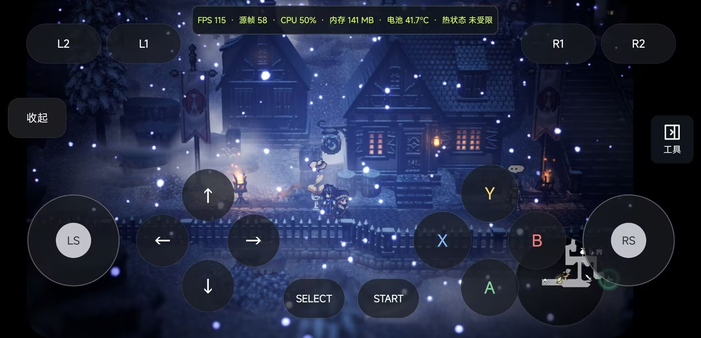
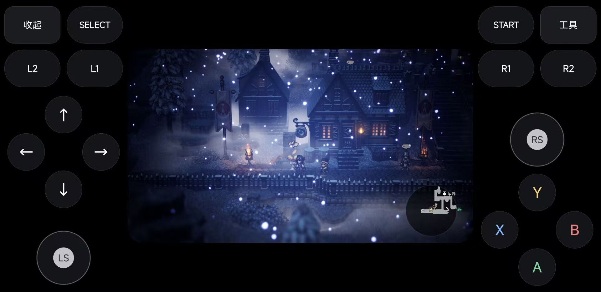

# 续幕 Xumu

在 Android 上玩 AVG 和 PC 游戏。

续幕是一款 Android 本地游戏运行与管理应用，支持 ONS、KRKR 与 PC 引擎，将游戏管理、画面增强和游玩工具带到手机上。

[官方网站](https://api.dixonmxl.com/xumu/site/) · [下载正式版](https://github.com/zhxyComing/XuMu/releases/tag/v0.1.3) · [在线使用指南](https://api.dixonmxl.com/xumu/site/guide/index.html) · [版本更新记录](CHANGELOG.md)

## 界面预览

### 常规模式

查看最近游玩、游戏库与添加游戏入口。

### 主机模式

横屏浏览本地游戏、收藏与游戏单，支持手柄导航。

## 主要功能

### AVG 体验

- **多引擎支持**：按游戏选择 ONS、KRKR 或 PC 运行方式。
- **画面增强**：在支持的游戏中使用超分辨率和智能插帧。
- **字幕与 AI 翻译**：回看和复制对白，使用自己的翻译服务配置查看译文；ONS／KRKR 支持可靠对白的翻译预取，减少逐句等待。
- **游戏控制台**：管理操作方式、显示、字幕与常用工具。
- **存档与备份**：保存游戏进度，备份支持范围内的存档、设置与游戏记录。

### 画面增强与 AI 翻译

在游戏控制中心调整支持的画面增强功能。

查看原文与译文，并按需复制文字。

### PC 游戏

- **PC 游戏运行**：运行具备有效启动入口的本地 PC 游戏，不限于 AVG。
- **运行组件与驱动**：按设备与游戏需要选择适用组件。
- **键位适配**：调整触屏、键鼠快捷键与手柄映射。
- **修改器接入**：接入自行准备且版本匹配的部分风灵月影修改器。
- **PC 文件管理与性能监测**：管理游戏相关文件，查看运行情况。

### 修改器与虚拟手柄

查看支持的修改项目；具体可用项目取决于游戏和修改器版本。

常规布局在游戏画面上提供方向、摇杆与操作按键。

侧边布局将按键放在两侧，保留中间游戏区域。

### 游戏管理

- 文件夹、ZIP、RAR、7z、常见分卷压缩包与批量导入。
- 安卓设备间局域网快传，支持配对、后台传输和暂停续传。
- 封面、收藏、搜索、游戏单与最近游玩。
- 触屏操作、虚拟按键与外接手柄。
- 游戏截图查看、管理与导出。
- 游玩记录和存储管理。

## 下载与安装

当前正式版为 **0.1.3**，要求 **Android 10 或更高版本、ARM64 设备**。

1. 打开 [0.1.3 发布页](https://github.com/zhxyComing/XuMu/releases/tag/v0.1.3)。
2. 在 **Assets** 中下载 `Xumu-0.1.3-release.apk`。
3. 在 Android 设备上打开安装包，按系统提示安装。
4. 准备完整游戏文件，按照 [快速开始](https://api.dixonmxl.com/xumu/site/guide/first-game.html) 添加第一款游戏。

安装包约 202 MiB，提供[官网下载](https://api.dixonmxl.com/xumu/site/download.html)和 GitHub Releases 下载。更新安装前请保留重要备份。

已安装续幕的用户，可在 **我的 → 关于续幕 → 检查更新** 中下载新版本；主机模式入口为 **设置 → 关于续幕 → 检查更新**。

## 使用指南

- [运行第一款游戏](https://api.dixonmxl.com/xumu/site/guide/first-game.html)
- [选择导入方式](https://api.dixonmxl.com/xumu/site/guide/import-method.html)
- [运行方式怎么选](https://api.dixonmxl.com/xumu/site/guide/choose-engine.html)
- [字幕与 AI 翻译](https://api.dixonmxl.com/xumu/site/guide/translation.html)
- [创建与导出备份](https://api.dixonmxl.com/xumu/site/guide/create-backup.html)
- [兼容性与问题排查](https://api.dixonmxl.com/xumu/site/guide/compatibility.html)
- [完整指南目录](https://api.dixonmxl.com/xumu/site/guide/index.html)

也可以阅读排版完整的 [官网使用指南](https://api.dixonmxl.com/xumu/site/guide/index.html)。指南对应正式版 0.1.2。

## 使用说明

- 游戏文件和修改器需自行合法准备，续幕不提供第三方游戏资源。
- 兼容性与功能支持因游戏、运行方式及设备而异，不保证所有游戏都能完整运行。
- AI 翻译需自行配置服务；费用和文本处理规则以所选服务商为准。部分游戏文字可能无法读取。
- 普通备份不包含游戏本体和完整运行环境，PC 存档需确认保存位置。
- 修改器需匹配游戏版本；使用前先备份重要进度。

## 问题反馈

在应用内打开 **设置 → 关于 → 反馈**。建议提供应用版本、设备型号、游戏名称与版本、运行方式、复现步骤和错误提示。

请勿在反馈中填写 API Key、账号密码或不必要的个人信息。详细操作见 [收集诊断与提交反馈](https://api.dixonmxl.com/xumu/site/guide/diagnostics.html)。
